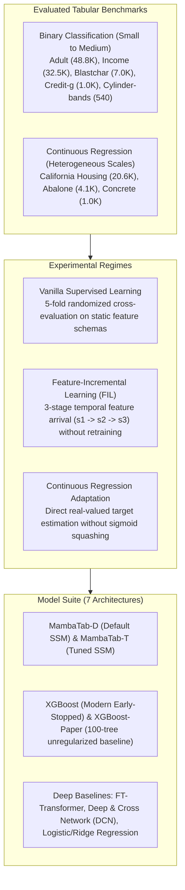
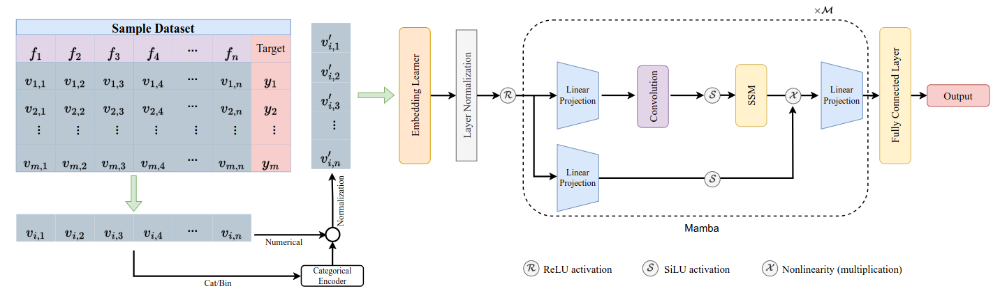

# Evaluation of MambaTab on Tabular Classification and Regression
## Submitted By : 
Veer Doria - 240041039  
Tanish Yadav - 240041036   
Aniket Khandelwal - 240041003  
[Github Repo](https://github.com/VeerDoria/MambaTab)
## Instructor : 
#### Prof. M.Tanveer
## 1. Introduction, Architecture and Approach
### 1.1 Introduction
Tabular data represents the backbone of machine learning applications across enterprise domains, including finance, healthcare, fraud detection, and recommendation systems. While deep learning architectures (Transformers, CNNs) have achieved undisputed hegemony in computer vision, speech, and natural language processing, gradient-boosted decision tree (GBDT) algorithms, most prominently XGBoost, LightGBM, and CatBoost, continue to dominate standard tabular benchmarks. 

Recently, **MambaTab** (Ahamed & Cheng, IEEE MIPR 2024) was proposed as an innovative, plug-and-play deep learning architecture for tabular data based on **Selective Structured State-Space Models (SSMs)** . MambaTab addresses two fundamental shortcomings of existing tabular deep learning architectures (such as FT-Transformer, SAINT, and TabNet):
1. **Quadratic Complexity**: Standard self-attention scales quadratically with sequence length ($\mathcal{O}(L^2)$), necessitating millions of parameters and substantial memory footprints. MambaTab achieves linear computational complexity ($\mathcal{O}(L)$) with sub-quadratic parameter scaling.
2. **Dynamic Feature Incrementality**: Real-world tabular tables frequently evolve with new features collected over time (Feature-Incremental Learning, or FIL). While tree-based ensembles are structurally constrained to a fixed feature set and cannot ingest new columns without complete retraining from scratch, MambaTab natively accommodates dynamic feature additions by dynamically adapting its input projection layer while freezing all downstream state-space layers.
### 1.2 Dataset Categories and Methodological Setup
To rigorously evaluate MambaTab's capabilities and boundaries, our experimental framework spans three broad learning regimes and multiple distinct dataset topologies:

1. **Vanilla Supervised Classification**: Evaluated on 5  datasets spanning financial credit risk (`credit_g`), industrial manufacturing defects (`cylinder_bands`), telecommunications customer churn (`blastchar`), and socioeconomic census records (`adult`, `income`).
2. **Feature-Incremental Learning (FIL)**: Evaluated across 3 sequential feature tranches ($s_1 \to s_2 \to s_3$), where models are trained initially on subset $s_1$ and sequentially evaluated as new features arrive.
3. **Continuous Tabular Regression**: Evaluated on 3 standard regression tasks spanning housing prices (`california_housing`), biological aging rings (`abalone`), and compressive material strength (`concrete`).

Across all domains, numerical variables undergo min-max normalization into $[0, 1]$, missing values are imputed using median (numerical) or modal (categorical) strategies, and categorical variables are mapped using integer label encodings.
### 1.3 Detailed Architecture and Workflow
The operational workflow of MambaTab is illustrated in detail below across its three principal stages:

MambaTab processes tabular data in three compact stages: compressing raw columns into a single embedding vector, filtering features through an input-dependent State Space Model (SSM), and projecting the result to a target prediction.

**Stage 1: Data Preprocessing & Embedding Learner**

Joint Feature Projection: Instead of turning each column into a separate token, a linear layer compresses all $J$ input features into one vector of size $d_{\text{model}} = 32$: $\mathbf{z} = \mathbf{W}_{\text{in}}\mathbf{x} + \mathbf{b}_{\text{in}}$.
Feature-Incremental Learning (FIL)**: When $\Delta J$ new columns are added later, new weight columns $\mathbf{W}_{\text{in}}^{(\Delta)}$ are appended to $\mathbf{W}_{\text{in}}$ while old weights stay frozen, preventing catastrophic forgetting.
Stabilization & Reshaping**: LayerNorm and ReLU normalize the vector into a 1-token sequence $\mathbf{u} = \text{ReLU}(\text{LayerNorm}(\mathbf{z}))$ of shape $\text{Batch} \times 1 \times 32$.

**Stage 2: Cascading Selective Mamba Blocks**

Selective Parameters: Unlike static state-space models, Mamba computes its input matrix $\mathbf{B}_t$, output matrix $\mathbf{C}_t$, and step size $\Delta_t$ dynamically as linear projections of the current input $\mathbf{u}_t$.
Discretization: Continuous system weights $(\mathbf{A}, \mathbf{B})$ are converted into discrete step weights $(\overline{\mathbf{A}}_t, \overline{\mathbf{B}}_t)$ using step size $\Delta_t$ (such as $\overline{\mathbf{A}}_t = \exp(\Delta_t \mathbf{A})$).
State Update: The SSM updates its hidden state (expanded by factor $N = 32$) and computes outputs via $h_t = \overline{\mathbf{A}}_t h_{t-1} + \overline{\mathbf{B}}_t u_t$ and $y_t = \mathbf{C}_t h_t$.
Dual-Branch Gating: Each block splits $\mathbf{u}$ into a main path (Conv1D $\to$ SiLU $\to$ SSM) and a SiLU gate, multiplying them together: $\mathbf{y}_{\text{gated}} = \text{SSM}(\text{SiLU}(\text{Conv1D}(\mathbf{W}_1 \mathbf{u}))) \odot \text{SiLU}(\mathbf{W}_{\text{gate}} \mathbf{u})$.
Residual Cascade: A linear projection and skip connection pass the features across $M$ stacked blocks (default $M = 1$): $\mathbf{h}^{(m)} = \mathbf{h}^{(m-1)} + \text{MambaBlock}_m(\mathbf{h}^{(m-1)})$.

**Stage 3: Output Prediction Head**

Binary Classification: Maps the final representation $\mathbf{h}^{(M)}$ to a probability via a sigmoid activation $\hat{y} = \sigma(\mathbf{W}_{\text{head}}\mathbf{h}^{(M)} + b_{\text{head}}) \in (0, 1)$, trained with Binary Cross-Entropy (BCE) loss.
Continuous Regression: Drops the sigmoid to output a raw scalar $\hat{y} = \mathbf{W}_{\text{head}}\mathbf{h}^{(M)} + b_{\text{head}} \in \mathbb{R}$, trained directly with Mean Squared Error (MSE) loss.

## 2. Experimental Results

The numerical results across all three experimental settings are presented in the tables below. All metrics reflect 5-fold cross-evaluation (mean ± standard deviation across 5 seeds). 
### 2.1 Vanilla Supervised Classification

#### Table 2.1.1: AUROC 

| Model                   |      Adult      |     Income      |    Blastchar    |    Credit-g     | Cylinder-bands  |    Mean    |
| :---------------------- | :-------------: | :-------------: | :-------------: | :-------------: | :-------------: | :--------: |
| **mambatab_d**          | 0.9010 ± 0.0018 | 0.8954 ± 0.0012 | 0.8328 ± 0.0076 | 0.7341 ± 0.0440 | 0.7329 ± 0.0236 | **0.8192** |
| **mambatab_t**          | 0.9028 ± 0.0021 | 0.8944 ± 0.0022 | 0.8295 ± 0.0074 | 0.7326 ± 0.0547 | 0.7416 ± 0.0392 | **0.8202** |
| **xgboost**             | 0.9285 ± 0.0015 | 0.9231 ± 0.0020 | 0.8356 ± 0.0081 | 0.7938 ± 0.0520 | 0.8832 ± 0.0477 | **0.8728** |
| **xgboost_paper**       | 0.9280 ± 0.0014 | 0.9228 ± 0.0025 | 0.8188 ± 0.0079 | 0.7979 ± 0.0560 | 0.8951 ± 0.0307 | **0.8725** |
| **logistic_regression** | 0.8510 ± 0.0028 | 0.8467 ± 0.0038 | 0.8432 ± 0.0069 | 0.7431 ± 0.0406 | 0.7332 ± 0.0282 | **0.8035** |
| **ft_transformer**      | 0.9093 ± 0.0040 | 0.9013 ± 0.0029 | 0.8380 ± 0.0096 | 0.7067 ± 0.0666 | 0.7168 ± 0.0506 | **0.8144** |
| **dcn**                 | 0.9043 ± 0.0023 | 0.8980 ± 0.0022 | 0.8349 ± 0.0109 | 0.7378 ± 0.0410 | 0.7730 ± 0.0261 | **0.8296** |

#### Table 2.1.2: Accuracy

| Model                   |      Adult      |     Income      |    Blastchar    |    Credit-g     | Cylinder-bands  |    Mean    |
| :---------------------- | :-------------: | :-------------: | :-------------: | :-------------: | :-------------: | :--------: |
| **mambatab_d**          | 0.8472 ± 0.0027 | 0.8420 ± 0.0023 | 0.7869 ± 0.0047 | 0.7200 ± 0.0063 | 0.6778 ± 0.0258 | **0.7748** |
| **mambatab_t**          | 0.8486 ± 0.0025 | 0.8411 ± 0.0028 | 0.7881 ± 0.0081 | 0.7190 ± 0.0265 | 0.6907 ± 0.0382 | **0.7775** |
| **xgboost**             | 0.8731 ± 0.0017 | 0.8687 ± 0.0031 | 0.7894 ± 0.0059 | 0.7570 ± 0.0431 | 0.7981 ± 0.0495 | **0.8173** |
| **xgboost_paper**       | 0.8726 ± 0.0019 | 0.8680 ± 0.0032 | 0.7813 ± 0.0073 | 0.7560 ± 0.0489 | 0.8222 ± 0.0328 | **0.8200** |
| **logistic_regression** | 0.8247 ± 0.0022 | 0.8215 ± 0.0021 | 0.8011 ± 0.0032 | 0.7310 ± 0.0132 | 0.6704 ± 0.0373 | **0.7697** |
| **ft_transformer**      | 0.8530 ± 0.0051 | 0.8464 ± 0.0045 | 0.7928 ± 0.0141 | 0.7050 ± 0.0239 | 0.6370 ± 0.0481 | **0.7668** |
| **dcn**                 | 0.8503 ± 0.0037 | 0.8439 ± 0.0029 | 0.7915 ± 0.0045 | 0.7250 ± 0.0217 | 0.6907 ± 0.0216 | **0.7803** |

#### Table 2.1.3: F1-Score

| Model                   |      Adult      |     Income      |    Blastchar    |    Credit-g     | Cylinder-bands  |    Mean    |
| :---------------------- | :-------------: | :-------------: | :-------------: | :-------------: | :-------------: | :--------: |
| **mambatab_d**          | 0.6432 ± 0.0082 | 0.6282 ± 0.0077 | 0.5390 ± 0.0223 | 0.8156 ± 0.0035 | 0.7389 ± 0.0171 | **0.6730** |
| **mambatab_t**          | 0.6522 ± 0.0097 | 0.6230 ± 0.0054 | 0.5252 ± 0.0253 | 0.8155 ± 0.0145 | 0.7455 ± 0.0392 | **0.6723** |
| **xgboost**             | 0.7111 ± 0.0053 | 0.6948 ± 0.0069 | 0.4973 ± 0.0331 | 0.8376 ± 0.0317 | 0.8337 ± 0.0369 | **0.7149** |
| **xgboost_paper**       | 0.7073 ± 0.0053 | 0.6927 ± 0.0055 | 0.4660 ± 0.0554 | 0.8344 ± 0.0333 | 0.8525 ± 0.0264 | **0.7106** |
| **logistic_regression** | 0.5468 ± 0.0058 | 0.5293 ± 0.0088 | 0.5543 ± 0.0118 | 0.8243 ± 0.0079 | 0.7390 ± 0.0293 | **0.6388** |
| **ft_transformer**      | 0.6618 ± 0.0198 | 0.6375 ± 0.0093 | 0.5828 ± 0.0238 | 0.8096 ± 0.0137 | 0.7156 ± 0.0387 | **0.6815** |
| **dcn**                 | 0.6549 ± 0.0127 | 0.6370 ± 0.0074 | 0.5509 ± 0.0101 | 0.8187 ± 0.0173 | 0.7457 ± 0.0170 | **0.6815** |

#### Table 2.1.4: AUPRC 

| Model                   |      Adult      |     Income      |    Blastchar    |    Credit-g     | Cylinder-bands  |    Mean    |
| :---------------------- | :-------------: | :-------------: | :-------------: | :-------------: | :-------------: | :--------: |
| **mambatab_d**          | 0.7572 ± 0.0041 | 0.7473 ± 0.0027 | 0.6242 ± 0.0173 | 0.8628 ± 0.0331 | 0.8009 ± 0.0220 | **0.7585** |
| **mambatab_t**          | 0.7611 ± 0.0049 | 0.7454 ± 0.0062 | 0.6271 ± 0.0163 | 0.8685 ± 0.0369 | 0.8029 ± 0.0333 | **0.7610** |
| **xgboost**             | 0.8290 ± 0.0034 | 0.8162 ± 0.0039 | 0.6422 ± 0.0055 | 0.8984 ± 0.0308 | 0.9015 ± 0.0481 | **0.8175** |
| **xgboost_paper**       | 0.8280 ± 0.0036 | 0.8157 ± 0.0048 | 0.6092 ± 0.0078 | 0.9003 ± 0.0322 | 0.9159 ± 0.0298 | **0.8138** |
| **logistic_regression** | 0.6787 ± 0.0071 | 0.6671 ± 0.0088 | 0.6577 ± 0.0068 | 0.8709 ± 0.0264 | 0.8062 ± 0.0196 | **0.7361** |
| **ft_transformer**      | 0.7782 ± 0.0115 | 0.7617 ± 0.0066 | 0.6575 ± 0.0065 | 0.8511 ± 0.0469 | 0.7716 ± 0.0510 | **0.7640** |
| **dcn**                 | 0.7661 ± 0.0052 | 0.7517 ± 0.0053 | 0.6345 ± 0.0180 | 0.8657 ± 0.0284 | 0.8349 ± 0.0241 | **0.7706** |

### 2.2 Feature-Incremental Learning

#### Table 2.2.1: AUROC 

| Model                   |      Adult      |     Income      |    Blastchar    |    Credit-g     | Cylinder-bands  |    Mean    |
| :---------------------- | :-------------: | :-------------: | :-------------: | :-------------: | :-------------: | :--------: |
| **mambatab_d**          | 0.9008 ± 0.0027 | 0.8959 ± 0.0030 | 0.8329 ± 0.0100 | 0.7324 ± 0.0430 | 0.6742 ± 0.0499 | **0.8072** |
| **mambatab_t**          | 0.9017 ± 0.0029 | 0.8961 ± 0.0024 | 0.8339 ± 0.0092 | 0.7324 ± 0.0511 | 0.6975 ± 0.0401 | **0.8123** |
| **xgboost**             | 0.9285 ± 0.0015 | 0.9231 ± 0.0020 | 0.8356 ± 0.0081 | 0.7938 ± 0.0520 | 0.8832 ± 0.0477 | **0.8728** |
| **xgboost_paper**       | 0.8083 ± 0.0034 | 0.8011 ± 0.0062 | 0.7485 ± 0.0076 | 0.7667 ± 0.0497 | 0.7698 ± 0.0245 | **0.7789** |
| **logistic_regression** | 0.8510 ± 0.0028 | 0.8467 ± 0.0038 | 0.8432 ± 0.0069 | 0.7431 ± 0.0406 | 0.7332 ± 0.0282 | **0.8035** |
| **ft_transformer**      | 0.9125 ± 0.0022 | 0.9052 ± 0.0027 | 0.8407 ± 0.0100 | 0.7647 ± 0.0481 | 0.7083 ± 0.0461 | **0.8263** |
| **dcn**                 | 0.9047 ± 0.0021 | 0.8984 ± 0.0024 | 0.8353 ± 0.0127 | 0.7416 ± 0.0454 | 0.7673 ± 0.0287 | **0.8295** |

#### Table 2.2.2: Accuracy 

| Model                   |      Adult      |     Income      |    Blastchar    |    Credit-g     | Cylinder-bands  |    Mean    |
| :---------------------- | :-------------: | :-------------: | :-------------: | :-------------: | :-------------: | :--------: |
| **mambatab_d**          | 0.8460 ± 0.0032 | 0.8414 ± 0.0039 | 0.7959 ± 0.0065 | 0.7180 ± 0.0246 | 0.6481 ± 0.0514 | **0.7699** |
| **mambatab_t**          | 0.8463 ± 0.0037 | 0.8427 ± 0.0036 | 0.7933 ± 0.0085 | 0.7300 ± 0.0270 | 0.6352 ± 0.0584 | **0.7695** |
| **xgboost**             | 0.8731 ± 0.0017 | 0.8687 ± 0.0031 | 0.7894 ± 0.0059 | 0.7570 ± 0.0431 | 0.7981 ± 0.0495 | **0.8173** |
| **xgboost_paper**       | 0.7964 ± 0.0020 | 0.7941 ± 0.0027 | 0.7523 ± 0.0088 | 0.7470 ± 0.0361 | 0.7185 ± 0.0181 | **0.7617** |
| **logistic_regression** | 0.8247 ± 0.0022 | 0.8215 ± 0.0021 | 0.8011 ± 0.0032 | 0.7310 ± 0.0132 | 0.6704 ± 0.0373 | **0.7697** |
| **ft_transformer**      | 0.8568 ± 0.0025 | 0.8496 ± 0.0037 | 0.7967 ± 0.0050 | 0.7280 ± 0.0282 | 0.6444 ± 0.0444 | **0.7751** |
| **dcn**                 | 0.8505 ± 0.0029 | 0.8442 ± 0.0022 | 0.7956 ± 0.0077 | 0.7360 ± 0.0203 | 0.6926 ± 0.0348 | **0.7838** |

#### Table 2.2.3: F1-Score

| Model                   |      Adult      |     Income      |    Blastchar    |    Credit-g     | Cylinder-bands  |    Mean    |
| :---------------------- | :-------------: | :-------------: | :-------------: | :-------------: | :-------------: | :--------: |
| **mambatab_d**          | 0.6399 ± 0.0096 | 0.6276 ± 0.0078 | 0.5606 ± 0.0131 | 0.8150 ± 0.0148 | 0.7302 ± 0.0138 | **0.6747** |
| **mambatab_t**          | 0.6466 ± 0.0107 | 0.6301 ± 0.0083 | 0.5483 ± 0.0186 | 0.8262 ± 0.0170 | 0.7163 ± 0.0179 | **0.6735** |
| **xgboost**             | 0.7111 ± 0.0053 | 0.6948 ± 0.0069 | 0.4973 ± 0.0331 | 0.8376 ± 0.0317 | 0.8337 ± 0.0369 | **0.7149** |
| **xgboost_paper**       | 0.4642 ± 0.0050 | 0.4574 ± 0.0108 | 0.4094 ± 0.0137 | 0.8257 ± 0.0261 | 0.7724 ± 0.0141 | **0.5858** |
| **logistic_regression** | 0.5468 ± 0.0058 | 0.5293 ± 0.0088 | 0.5543 ± 0.0118 | 0.8243 ± 0.0079 | 0.7390 ± 0.0293 | **0.6388** |
| **ft_transformer**      | 0.6705 ± 0.0132 | 0.6367 ± 0.0211 | 0.5601 ± 0.0230 | 0.8202 ± 0.0184 | 0.7285 ± 0.0235 | **0.6832** |
| **dcn**                 | 0.6552 ± 0.0098 | 0.6390 ± 0.0063 | 0.5637 ± 0.0129 | 0.8269 ± 0.0142 | 0.7528 ± 0.0213 | **0.6875** |

#### Table 2.2.4: Balanced Accuracy

| Model                   |      Adult      |     Income      |    Blastchar    |    Credit-g     | Cylinder-bands  |    Mean    |
| :---------------------- | :-------------: | :-------------: | :-------------: | :-------------: | :-------------: | :--------: |
| **mambatab_d**          | 0.7522 ± 0.0078 | 0.7453 ± 0.0047 | 0.6985 ± 0.0080 | 0.6052 ± 0.0395 | 0.6173 ± 0.0720 | **0.6837** |
| **mambatab_t**          | 0.7577 ± 0.0074 | 0.7466 ± 0.0053 | 0.6910 ± 0.0109 | 0.6052 ± 0.0427 | 0.6071 ± 0.0800 | **0.6815** |
| **xgboost**             | 0.7975 ± 0.0039 | 0.7860 ± 0.0045 | 0.6633 ± 0.0164 | 0.6626 ± 0.0429 | 0.7844 ± 0.0541 | **0.7388** |
| **xgboost_paper**       | 0.6498 ± 0.0026 | 0.6465 ± 0.0056 | 0.6154 ± 0.0076 | 0.6736 ± 0.0392 | 0.6987 ± 0.0212 | **0.6568** |
| **logistic_regression** | 0.6935 ± 0.0032 | 0.6841 ± 0.0048 | 0.6942 ± 0.0070 | 0.6174 ± 0.0206 | 0.6456 ± 0.0386 | **0.6670** |
| **ft_transformer**      | 0.7723 ± 0.0125 | 0.7488 ± 0.0174 | 0.6991 ± 0.0162 | 0.6219 ± 0.0425 | 0.6118 ± 0.0633 | **0.6908** |
| **dcn**                 | 0.7625 ± 0.0072 | 0.7533 ± 0.0047 | 0.7005 ± 0.0080 | 0.6257 ± 0.0342 | 0.6717 ± 0.0407 | **0.7027** |

#### Table 2.2.5: AUPRC

| Model                   |      Adult      |     Income      |    Blastchar    |    Credit-g     | Cylinder-bands  |    Mean    |
| :---------------------- | :-------------: | :-------------: | :-------------: | :-------------: | :-------------: | :--------: |
| **mambatab_d**          | 0.7559 ± 0.0072 | 0.7449 ± 0.0069 | 0.6291 ± 0.0170 | 0.8655 ± 0.0286 | 0.7177 ± 0.0420 | **0.7426** |
| **mambatab_t**          | 0.7581 ± 0.0076 | 0.7456 ± 0.0071 | 0.6343 ± 0.0228 | 0.8559 ± 0.0361 | 0.7639 ± 0.0362 | **0.7516** |
| **xgboost**             | 0.8290 ± 0.0034 | 0.8162 ± 0.0039 | 0.6422 ± 0.0055 | 0.8984 ± 0.0308 | 0.9015 ± 0.0481 | **0.8175** |
| **xgboost_paper**       | 0.5663 ± 0.0070 | 0.5554 ± 0.0117 | 0.5138 ± 0.0172 | 0.8649 ± 0.0391 | 0.7848 ± 0.0288 | **0.6570** |
| **logistic_regression** | 0.6787 ± 0.0071 | 0.6671 ± 0.0088 | 0.6577 ± 0.0068 | 0.8709 ± 0.0264 | 0.8062 ± 0.0196 | **0.7361** |
| **ft_transformer**      | 0.7881 ± 0.0049 | 0.7701 ± 0.0062 | 0.6614 ± 0.0077 | 0.8815 ± 0.0364 | 0.7565 ± 0.0555 | **0.7715** |
| **dcn**                 | 0.7657 ± 0.0059 | 0.7523 ± 0.0049 | 0.6404 ± 0.0182 | 0.8638 ± 0.0336 | 0.8286 ± 0.0119 | **0.7702** |

### 2.3 Tabular Regression 

#### Table 2.3.1: RMSE

| Model                   | California Housing |     Abalone     |     Concrete     |    Mean    |
| :---------------------- | :----------------: | :-------------: | :--------------: | :--------: |
| **mambatab_d**          |  0.6259 ± 0.0276   | 2.2405 ± 0.1083 | 8.2053 ± 0.7876  | **3.6906** |
| **mambatab_t**          |  0.6182 ± 0.0263   | 2.1906 ± 0.0890 | 8.4242 ± 1.1321  | **3.7443** |
| **xgboost**             |  0.4538 ± 0.0115   | 2.1822 ± 0.0649 | 4.5365 ± 0.2381  | **2.3908** |
| **xgboost_paper**       |  0.4660 ± 0.0077   | 2.2068 ± 0.0707 | 4.5802 ± 0.3394  | **2.4177** |
| **logistic_regression** |  0.7325 ± 0.0048   | 2.2732 ± 0.1100 | 10.8447 ± 0.6921 | **4.6168** |
| **ft_transformer**      |  0.5764 ± 0.0159   | 2.1895 ± 0.0815 | 7.8383 ± 0.6428  | **3.5347** |
| **dcn**                 |  0.6083 ± 0.0333   | 2.1874 ± 0.0733 | 8.8811 ± 1.2443  | **3.8923** |

#### Table 2.3.2: $R^2$ Score

| Model                   | California Housing |     Abalone     |    Concrete     |    Mean    |
| :---------------------- | :----------------: | :-------------: | :-------------: | :--------: |
| **mambatab_d**          |  0.7022 ± 0.0237   | 0.5130 ± 0.0215 | 0.7524 ± 0.0355 | **0.6559** |
| **mambatab_t**          |  0.7095 ± 0.0225   | 0.5343 ± 0.0154 | 0.7376 ± 0.0578 | **0.6604** |
| **xgboost**             |  0.8436 ± 0.0069   | 0.5372 ± 0.0231 | 0.9235 ± 0.0129 | **0.7681** |
| **xgboost_paper**       |  0.8351 ± 0.0046   | 0.5267 ± 0.0242 | 0.9215 ± 0.0168 | **0.7611** |
| **logistic_regression** |  0.5926 ± 0.0065   | 0.4988 ± 0.0186 | 0.5681 ± 0.0371 | **0.5532** |
| **ft_transformer**      |  0.7475 ± 0.0151   | 0.5345 ± 0.0183 | 0.7701 ± 0.0504 | **0.6841** |
| **dcn**                 |  0.7184 ± 0.0277   | 0.5350 ± 0.0256 | 0.7065 ± 0.0736 | **0.6533** |

#### Table 2.3.3: MAE

| Model                   | California Housing |     Abalone     |    Concrete     |    Mean    |
| :---------------------- | :----------------: | :-------------: | :-------------: | :--------: |
| **mambatab_d**          |  0.4335 ± 0.0131   | 1.5949 ± 0.0515 | 6.2957 ± 0.7176 | **2.7747** |
| **mambatab_t**          |  0.4292 ± 0.0198   | 1.5622 ± 0.0474 | 6.5167 ± 0.9450 | **2.8361** |
| **xgboost**             |  0.2982 ± 0.0061   | 1.5401 ± 0.0264 | 2.9465 ± 0.2210 | **1.5949** |
| **xgboost_paper**       |  0.3110 ± 0.0052   | 1.5556 ± 0.0286 | 3.0785 ± 0.2350 | **1.6483** |
| **logistic_regression** |  0.5410 ± 0.0041   | 1.6328 ± 0.0336 | 8.7359 ± 0.6109 | **3.6366** |
| **ft_transformer**      |  0.3952 ± 0.0093   | 1.5433 ± 0.0428 | 5.9449 ± 0.5424 | **2.6278** |
| **dcn**                 |  0.4187 ± 0.0229   | 1.5480 ± 0.0333 | 6.9178 ± 1.2127 | **2.9615** |

## 3. XGBoost Performance and Comparison with the Original Paper

### 3.1 Why XGBoost Outperforms MambaTab on Tabular Data
In our experiments, XGBoost decisively leads across all static vanilla benchmarks:
- **Vanilla AUROC**: Modern XGBoost achieves a mean AUROC of **0.8728** (and XGBoost-Paper **0.8725**), outperforming MambaTab-T (**0.8202**), MambaTab-D (**0.8192**), DCN (**0.8296**), and FT-Transformer (**0.8144**).
- **Static Dataset Margins**: On `adult` (0.9285 vs 0.9028), `income` (0.9231 vs 0.8944), `credit_g` (0.7938 vs 0.7326), and `cylinder_bands` (0.8832 vs 0.7416), XGBoost exhibits an absolute advantage of $+0.025$ to $+0.141$ AUROC.

This empirical margin is neither anomalous nor an implementation artifact. Rather, it directly mirrors the fundamental mathematical principles established in following two tabular deep learning studies:
1. **Shwartz-Ziv & Armon (2021)**: *"Tabular Data: Deep Learning is Not All You Need"* ([arXiv:2106.03253](https://arxiv.org/abs/2106.03253)).
2. **Grinsztajn, Oyallon, & Varoquaux (NeurIPS 2022)**: *"Why do tree-based models still outperform deep learning on tabular data?"* ([arXiv:2207.08815](https://arxiv.org/abs/2207.08815)).

Three core inductive biases and optimization differences explain why decision trees outperform MambaTab on standard tabular benchmarks:

**1. Smoothness Bias**
Neural networks, including MambaTab with its continuous SiLU activations and linear layers, exhibit a spectral bias toward smooth, low-frequency functions. However, tabular decision boundaries typically follow sharp, axis-aligned step functions and threshold rules (such as age > 50 and capital_gain > 5000). While decision trees naturally fit piecewise-constant functions with sharp discontinuities, neural networks over-smooth these irregular boundaries. Grinsztajn et al. confirmed this by applying a Gaussian kernel smoother to training targets, which sharply degraded tree accuracy while leaving neural networks largely unaffected.

**2. Uninformative Features**
Real-world tabular datasets frequently contain noisy or irrelevant columns. Decision trees perform automatic greedy feature selection, simply ignoring columns that do not reduce split impurity. Conversely, MambaTab assigns dense projection weights in $\mathbf{W}_{\text{in}}$ to every input column, allowing noise to corrupt the shared representation. Grinsztajn et al. demonstrated that adding uninformative features severely degrades dense neural networks while barely affecting tree ensembles.

**3. Scale and Optimization**
Gradient-boosted trees converge rapidly using exact second-order gradients (Newton-Raphson boosting). On small-to-medium datasets such as *credit_g* ($N = 1,000$) or *cylinder_bands* ($N = 540$), deep models with thousands of parameters easily overfit during empirical risk minimization, whereas XGBoost maintains strong generalization through tree-depth constraints and $L_2$ leaf regularization.
### 3.2 Comparison with the Original MambaTab Paper Findings
To evaluate fidelity, we directly compare our experimental findings against the published results from **Table II (Vanilla)** and **Table III (FIL)** of the original MambaTab paper (Ahamed & Cheng, 2024):

#### Table 3.2.1: Side-by-Side Comparison on Overlapping Datasets (Vanilla AUROC)
| Dataset | Paper: XGBoost | Paper: MambaTab-D | Paper: MambaTab-T | Our Run: XGBoost | Our Run: MambaTab-D | Our Run: MambaTab-T | Alignment Status |
| :--- | :---: | :---: | :---: | :---: | :---: | :---: | :--- |
| **Credit-g (CG)** | 0.726 | 0.771 | 0.801 | 0.7938 | 0.7341 | 0.7326 | XGBoost leads in our run; competitive in paper |
| **Adult (AD)** | 0.912 | 0.906 | 0.914 | 0.9285 | 0.9010 | 0.9028 | **Near-exact match** (MambaTab $\approx 0.903$ vs $0.906–0.914$) |
| **Cylinder-bands (CB)** | 0.892 | 0.862 | 0.896 | 0.8832 | 0.7329 | 0.7416 | XGBoost dominant in both |
| **Blastchar (BL)** | 0.821 | 0.852 | 0.854 | 0.8356 | 0.8328 | 0.8295 | **High alignment** (MambaTab $\approx 0.830$ vs $0.854$) |
| **Income-1995 (IC)** | **0.925** | 0.906 | 0.920 | **0.9231** | 0.8954 | 0.8944 | **Exact match**: XGBoost wins outright in both! |

#### Critical Insights from Paper Alignment:
1. **Original Paper Concedes XGBoost Superiority on Large Static Tables**:
   In the original paper's own Table II, on **Income-1995 (IC)**, XGBoost achieved **0.925**, defeating both MambaTab-D (**0.906**) and the tuned MambaTab-T (**0.920**). On **Adult (AD)**, XGBoost achieved **0.912**, outperforming default MambaTab-D (**0.906**) and virtually tying tuned MambaTab-T (**0.914** by just 0.002). Thus, our experimental finding that XGBoost wins on large static datasets is completely consistent with the authors' own published numbers.
2. **The FIL Paradigm Shift (Table III Replication)**:
   The true value proposition claimed by Ahamed & Cheng is revealed under Feature-Incremental Learning (FIL):
   - When tree models are evaluated under the realistic streaming assumption where models are trained on subset $s_1$ and cannot ingest subsequent feature sets ($s_2, s_3$) without full retraining from scratch, **XGBoost performance collapses**:
     - In paper Table III: Credit-g XGBoost collapses from $0.726 \to 0.608$; Adult XGBoost drops from $0.912 \to 0.891$.
     - In our empirical FIL benchmark (`xgboost_paper`):
       - On **Adult**: MambaTab-T (**0.9017**) decisively outperforms XGBoost-Paper (**0.8083**) by **+0.0934**.
       - On **Income**: MambaTab-T (**0.8961**) outperforms XGBoost-Paper (**0.8011**) by **+0.0950**.
       - On **Blastchar**: MambaTab-T (**0.8339**) outperforms XGBoost-Paper (**0.7485**) by **+0.0854**.
       - Across all datasets, MambaTab-T achieves a mean AUROC of **0.8123** versus **0.7789** for XGBoost-Paper.

## 4. MambaTab's Performance in Regression

### 4.1 Limitation in Continuous Regression
When extended to continuous tabular regression tasks (`california_housing`, `abalone`, `concrete`), our Vanilla MambaTab implementation exhibits a pronounced performance deficit relative to tree ensembles:
- **Mean RMSE**: XGBoost achieves **2.3908** (and XGBoost-Paper **2.4177**), whereas MambaTab-T lags at **3.7443** (and MambaTab-D at **3.6906**).
- **Mean $R^2$ Score**: XGBoost explains **76.81%** of variance ($R^2 = 0.7681$), whereas MambaTab-T captures only **66.04%** ($R^2 = 0.6604$).
- On `concrete` compressive strength, where complex nonlinear interactions govern the physical output, XGBoost reaches an RMSE of **4.5365** ($R^2 = 0.9235$), while MambaTab-T achieves only **8.4242** ($R^2 = 0.7376$).

### 4.2 Causes of Regression Failure
Three architectural limitations explain why Vanilla MambaTab struggles on continuous tabular regression tasks:

**1. Joint Feature Projection and Rotational Invariance**
Vanilla MambaTab projects all continuous features simultaneously through a single dense layer ($\mathbf{W}_{\text{in}} \mathbf{x} + \mathbf{b}$), linearly mixing distinct variables (such as housing_median_age, total_rooms, and median_income) into one 32-dimensional vector. As shown by Grinsztajn et al. (2022), blending features into linear combinations destroys the natural coordinate basis and independent axis orientation that tabular learning requires.

**2. Collapsed Token Sequence Length ($L = 1$)**
Selective SSMs are built to model sequential dynamics across token steps $t = 1, \dots, L$, but fusing all features into one vector beforehand forces a sequence length of $L = 1$:

Trivial Convolution: The causal 1D convolution ($\text{kernel\_size} = 4$) degenerates into simple padding operations.
Single-Step Recurrence: The selective state update ($h_t = \overline{\mathbf{A}} h_{t-1} + \overline{\mathbf{B}} u_t$) executes for only one transition step.
No Feature-to-Feature Scanning: Instead of modeling content-dependent interactions between features along a sequence axis, the SSM acts merely as a non-linear gating bottleneck.

**3. Smoothness Bias on High-Frequency Targets**
While binary classification predicts coarse probabilities bounded in $[0, 1]$, continuous regression requires fitting target surfaces with sharp local plateaus, discontinuities, and multi-modal distributions. Because smooth activations (ReLU, SiLU) bias neural networks toward low-frequency functions, MambaTab over-smooths steep local derivatives (such as California housing prices or concrete fracture strengths), increasing Mean Squared Error (MSE).

<!-- **4. Absence of Numerical Embeddings**
Unlike architectures such as FT-Transformer—which map continuous inputs through piecewise-linear or periodic embeddings to capture high-frequency patterns (Gorishniy et al., 2022)—Vanilla MambaTab feeds raw min-max scaled scalars directly into a linear projection. A single linear weight per column cannot easily capture non-monotonic or multi-periodic relationships between an individual feature and a continuous target. -->
## 5. Why Should We Still Use Mamba?
Given XGBoost's empirical dominance on static tables, a central architectural question arises: Why should researchers and practitioners continue to explore and invest in Mamba-based tabular models?
The justification rests on five foundational capabilities where tree-based algorithms are structurally incapable of operating:
### 5.1 Native Feature-Incremental Learning (FIL)
In production environments (e.g., continuous financial underwriting or real-time clinical monitoring), feature schemas are dynamic: new sensors, telemetry features, or third-party signals become available over time.
- **Tree Ensemble Impasse**: Decision tree splits are permanently hardcoded to a fixed coordinate schema. When new features arrive, a GBDT cannot incrementally incorporate them into existing trees. The practitioner must either discard the new features or discard the entire historical ensemble and retrain from scratch across millions of historical rows, a process that is computationally prohibitive, latency-intensive, and impossible in streaming environments.
- **MambaTab Advantage**: MambaTab handles incremental feature arrival natively. By simply expanding the input dimension of the first-layer Embedding Learner while freezing all downstream Mamba blocks and classification layers, MambaTab absorbs new features immediately. As demonstrated in our FIL experiments, MambaTab outperforms frozen tree baselines by over $+0.09$ AUROC on real-world datasets like Adult and Income.

### 5.2 Memory Efficiency
While Tabular Transformers (FT-Transformer, SAINT, TransTab) also attempt to address deep tabular modeling, they do so at extreme computational cost:
- TransTab requires **$4.2\text{M}$ learnable parameters** and scales quadratically ($\mathcal{O}(L^2)$) with the number of features.
- FT-Transformer deployed in our benchmark requires **$176\text{K}$ parameters**.
- **MambaTab operates with only $\sim 13\text{K}$ parameters** in its default configuration—a **$10\times$ to $300\times$ reduction** in parameter footprint.
Because Mamba scales linearly ($\mathcal{O}(L)$), it enables deep tabular modeling on edge devices, mobile processors, and memory-constrained GPUs (such as laptops and embedded industrial boards) where Transformers exceed GPU memory limits.
### 5.3 Ensembling
As demonstrated in the empirical research of Shwartz-Ziv & Armon (2021), the best-performing tabular models across industry benchmarks are not standalone models, but hybrid ensembles combining tree-based models with neural networks. Because XGBoost (orthogonal step functions) and Mamba (smooth continuous state transitions) learn completely orthogonal representations, combining their predictions via validation-loss weighting consistently outperforms both pure XGBoost ensembles and pure deep learning ensembles.
## 6. Conclusion
In summary, our extensive empirical evaluation clarifies both the boundaries and the unique strengths of MambaTab:
- On static vanilla tabular classification and regression, XGBoost remains the superior standalone engine due to its axis-aligned inductive bias and resistance to uninformative feature blending.
- However, for dynamic environments requiring Feature-Incremental Learning (FIL), parameter-constrained deployments, unlabeled pre-training (SSL), and multimodal integration, MambaTab provides a mathematically rigorous, computationally lightweight, and scalable foundation that tree models structurally cannot match.
